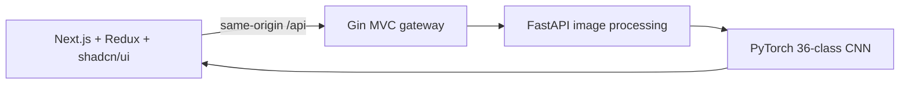

# InkLab — Handwritten Character Recognition

CodeAlpha Machine Learning Internship · Task 3

Recognize **single English letters A–Z and digits 0–9** from handwriting using a real PyTorch CNN trained on EMNIST. Both uppercase and lowercase handwriting are supported; letter predictions are normalized to uppercase. This is a 36-class, case-insensitive character recognizer.

**Stack:** Next.js 16 App Router · TypeScript · Redux Toolkit + React Redux · shadcn/ui · Gin (Go), following MVC · FastAPI · PyTorch.

## Start the app

Prerequisites: Node.js 20.9+, Go 1.24+, and Python 3.11–3.13. The verified local environment uses Node 24, Go 1.26, and Python 3.13 with CPU PyTorch 2.7.1.

```powershell
# First-time dependency installation:
powershell -ExecutionPolicy Bypass -File .\start_services.ps1 -Setup

# Subsequent starts:
powershell -ExecutionPolicy Bypass -File .\start_services.ps1
```

Open **http://127.0.0.1:3100**. Stop using:

```powershell
powershell -ExecutionPolicy Bypass -File .\stop_services.ps1
```

If Windows Application Control blocks the unsigned Go executable and Ubuntu WSL is installed, use:

```powershell
powershell -ExecutionPolicy Bypass -File .\start_services.ps1 -UseWSL
```

This builds the same Gin source for Linux and runs it in Ubuntu. Next.js and FastAPI remain on Windows; the launcher resolves their WSL network addresses automatically. No Windows security settings are changed. FastAPI binds only to the Windows WSL interface in this mode; its documentation URL is printed on startup. The stop script verifies the Linux executable before terminating it.

The launcher installs missing dependencies, checks ports, waits for model readiness, and writes logs to `.logs`. The default ports are frontend 3100, Gin 3101, and FastAPI 8100. Trained artifacts are included under `ml-service/saved_models`; training runs automatically only if the checkpoint is absent. The first dependency installation or dataset download requires network access.

## Recognition studio

- Draw a letter or digit using a mouse, pen, or touch. Adjust the stroke, erase, undo, or reset.
- Upload or drag and drop a PNG, JPEG, or WebP. Transparent images are composited on white.
- Choose **Letters + digits**, **Letters A–Z**, or **Digits 0–9**. Type-specific modes help distinguish inherently similar shapes such as O/0 and I/1.
- See the predicted character, top candidates, normalized 28 × 28 model input, and measured preprocessing/inference latency.
- Try all 36 classes using 108 actual EMNIST test images, with three fixed examples per class.
- Inspect class-level precision, recall, F1, training curves, and the full 36 × 36 confusion matrix in Model Lab. Export the measured metrics as JSON.
- Redux manages requests, results, samples, model metadata, history, and navigation. The latest 50 predictions persist in browser local storage. Export CSV or clear history.

An image must contain one isolated English letter or digit. The model does not recognize words, sentences, punctuation, or other scripts. Case is intentionally normalized; it does not distinguish `a` from `A`. Probabilities are uncalibrated and conditional on the selected character type. Unsupported images can still produce high scores. The 70% ambiguity indicator is a UI heuristic, not an evaluated rejection threshold.

## Dataset and training

The model uses **EMNIST Balanced**, downloaded directly from the [official NIST archive](https://biometrics.nist.gov/cs_links/EMNIST/gzip.zip). The dataset loader retrieves only the required ZIP members using HTTP byte ranges. Each member is CRC-checked by Python's ZIP reader; SHA-256 hashes are recorded in the dataset manifest and the saved evaluation report. The dataset is cached only under `ml-service/data` and excluded from Git.

EMNIST Balanced originally has 47 classes. The official mapping file maps their labels to character code points; this application folds the 11 separately represented lowercase forms into their uppercase alphabet identities, producing 36 output classes. Similar letter cases are already merged in the source dataset. As a result, the reported scores describe this **36-class case-insensitive task**, not the original 47-class benchmark. Some folded classes have twice as many examples, so the training loss uses inverse class-frequency weights.

The loader transposes stored EMNIST pixels into upright orientation. Training, validation, and test images all receive the same foreground cropping, 20-pixel fitting, and center-of-mass normalization used for inference.

| Dataset partition | Examples |
| --- | --- |
| Training | 101,520 |
| Validation, stratified within the official training split | 11,280 |
| Official test split | 18,800 |

Training uses seed 42, fifteen epochs, Adam with initial learning rate 0.001, a learning-rate reduction every five epochs, batch size 128, class-weighted cross entropy, and deterministic CPU operations. Only validation accuracy selects the checkpoint. The official test set is used once for final evaluation.

Training batches are augmented ([augment.py](ml-service/app/augment.py)); validation and test images are not:

- **Writing-style variants.** EMNIST was written by US census staff, so its "1" is almost always a bare vertical stroke. Without help, a flagged "1" was read as "7" and a "1" with a flag and base serif as "2". A quarter of the training "1"s get a flag drawn at the top, measured from the stroke's own slant, and 45% of those also get a horizontal base serif. 30% of "7" and "Z" glyphs get a European crossbar. The new strokes are re-normalized with the inference pipeline.
- **Geometry and pen width.** Half of each batch is randomly rotated (±8°), scaled (0.90–1.06), sheared (±0.15) and shifted (±5%). 10% of glyphs are dilated and 6% eroded to mimic bolder or finer pens.

Architecture: `1×28×28 → Conv(32,3×3)+ReLU+MaxPool → Conv(64,3×3)+ReLU+MaxPool → Dense(128)+ReLU+Dropout(0.3) → 36 logits`. The model has 424,996 trainable parameters.

| Measured result | Value |
| --- | --- |
| Overall test accuracy | 88.98% |
| Letter test accuracy | 89.22% |
| Digit test accuracy | 88.13% |
| Macro F1 | 88.05% |
| Best validation accuracy | 88.89% |
| Training time on this machine | 773.82 seconds |

See [metrics.json](ml-service/saved_models/metrics.json) for measured overall accuracy, letter accuracy, digit accuracy, macro F1, per-character statistics, confusion matrix, and training history. Letter and digit accuracies are measured against the **full vocabulary**, without restricting predictions to the known ground-truth type. Dataset scores do not establish equivalent accuracy on every writing style or camera image. Example images are the first three test records per character, selected independently of predictions.

A bare vertical stroke is genuinely ambiguous between 1, I and L, because EMNIST labels lowercase "l" as L. In the full vocabulary, "1" recall is 56.7%, which accounts for most of the digit-accuracy gap. Choosing **Digits 0-9** removes the ambiguity: on the official test digits, digits-mode accuracy is 99.10%.

## Reproduce training

```powershell
cd ml-service
python -m venv .venv
.\.venv\Scripts\python.exe -m pip install torch==2.7.1 --index-url https://download.pytorch.org/whl/cpu
.\.venv\Scripts\python.exe -m pip install -r requirements.txt
.\.venv\Scripts\python.exe train.py --epochs 15 --seed 42
```

Train with the ML service stopped, then restart it. Use `--output saved_models_experiment` to retain the deployed artifacts during another experiment. `MODEL_DIR` can select an alternate artifact directory for inference. `requirements-lock.txt` records the installed Python environment. Exact timing and floating-point results can vary with hardware and library versions.

The checkpoint contains its character vocabulary. FastAPI uses that vocabulary for output labels and checks that it agrees with the evaluation metadata; it does not assume a ten-digit output head.

## Architecture and MVC



The browser talks only to Next.js. A same-origin rewrite proxies to Gin, which enforces request size and JSON contracts, propagates cancellation, preserves ML validation errors, and applies a 30-second upstream timeout. FastAPI limits compressed images to 4 MB and decoded images to 4 million pixels. Inference runs in a worker thread with bounded concurrency. Backends process images in memory and do not save uploads; browser history stores inputs locally until cleared.

```text
backend-gateway/
  main.go         HTTP server startup
  config/         Environment configuration
  models/         Request and response data
  controllers/    HTTP validation and request flow
  views/          JSON response rendering
  services/       FastAPI client and service interface
  routes/         Route registration and dependency wiring
  middleware/     Shared response headers
```

The API view is JSON; the visual interface is implemented in Next.js. MVC folders sit directly under `backend-gateway`, with no `internal` wrapper.

## API

| Gin route | Method | Purpose |
| --- | --- | --- |
| `/health` | GET | Gateway liveness |
| `/api/health` | GET | ML readiness and supported classes |
| `/api/metrics` | GET | Actual saved evaluation |
| `/api/samples` | GET | 108 labeled EMNIST examples |
| `/api/predict` | POST | Predict one character |

Prediction request:

```json
{"image":"data:image/png;base64,...","mode":"all"}
```

`mode` can be `all` (default), `letters`, or `digits`. The response includes `prediction`, `confidence`, `probabilities`, `processed_image`, `latency_ms`, `model`, `mode`, `uncertain`, and `warning`. Probability lists contain 36, 26, or 10 candidates respectively and sum to one within that vocabulary. Error responses contain `detail`.

## Manual setup and Docker

After installing dependencies, start these in separate terminals:

```powershell
# FastAPI, from ml-service:
.\.venv\Scripts\python.exe -m uvicorn app.main:app --host 127.0.0.1 --port 8100
# Gin, from backend-gateway:
go run .
# Next.js, from frontend:
npm.cmd ci
npm.cmd run dev
```

For a production frontend use `npm.cmd run build` followed by `npm.cmd start`. Set `GATEWAY_URL` at build time for the production rewrite. Gin accepts `ML_SERVICE_URL` and `GATEWAY_ADDR`.

Alternatively, with a working Docker engine, run `docker compose up --build`. Compose starts all three services, uses the included checkpoint, and exposes only frontend port 3100 on loopback. Stop with `docker compose down`.

## Verification

```powershell
# From ml-service:
.\.venv\Scripts\python.exe -m unittest discover -s tests -v
# From backend-gateway:
go test ./...
go vet ./...
# From frontend:
npm.cmd run typecheck
npm.cmd run build
# With the full app running and Microsoft Edge installed:
$env:PLAYWRIGHT_CHANNEL='msedge'
npm.cmd run test:e2e
```

The browser tests can also use Playwright's Chromium when installed; omit the channel variable in that case. No workspace-level npm, Go, or browser cache is required.

ML tests cover all 36 labels, real probability distributions on 108 examples, alphabet label mapping, type-specific modes, blank rejection, polarity normalization, centering, corrupt/oversized images, and transparency. Browser tests cover letter and digit recognition through Next.js/Gin/FastAPI, all alphabet sample controls, drawing/undo/eraser, upload, persistent Redux history, CSV download, model metrics, and mobile overflow.

## References

- [NIST EMNIST dataset](https://www.nist.gov/itl/products-and-services/emnist-dataset), Gregory Cohen, Saeed Afshar, Jonathan Tapson, and André van Schaik. The images derive from NIST Special Database 19. Example PNGs are derived from the official EMNIST test split.
- [EMNIST research paper](https://arxiv.org/abs/1702.05373).
- [Redux Toolkit with Next.js](https://redux.js.org/usage/nextjs), [shadcn/ui](https://ui.shadcn.com/docs/installation/manual), [Next.js](https://nextjs.org/docs/app), [Gin](https://gin-gonic.com/docs/), and [FastAPI](https://fastapi.tiangolo.com/).

Developed for CodeAlpha Machine Learning Task 3. GitHub upload, LinkedIn posting, and submission-form completion are separate account actions.
